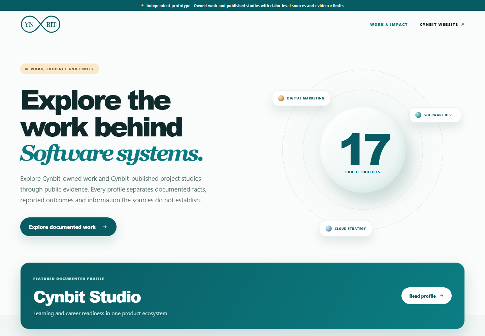
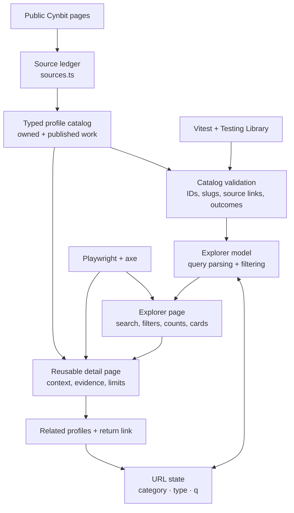

# Cynbit Work & Impact

> An evidence-aware case-study explorer for Cynbit's public work, built as an independent React prototype.

[](https://react.dev/)
[](https://www.typescriptlang.org/)
[](https://vite.dev/)
[](#quality-assurance)



## First impression

**Work & Impact** turns a static portfolio collection into a focused, professional discovery experience. A visitor arrives at a calm, Cynbit-inspired landing view: a concise statement of purpose, animated service orbit, verified scope, a featured profile, and a clear path into the work.

The experience is designed to answer three questions immediately:

1. **What work is represented?** Seventeen public profiles across software development, cloud strategy, and digital marketing.
2. **What can be trusted?** Every profile distinguishes Cynbit-owned work from Cynbit-published case studies and exposes its evidence limits.
3. **How do I explore it?** Search, category controls, related profiles, and URL-backed navigation make the collection quick to browse and easy to return to.

## What was improved

| Portfolio concern | Improvement delivered |
| --- | --- |
| Static, hard-to-explore content | Dynamic category and work-type filters, combined keyword search, result counts, empty states, and reset controls |
| Unclear credibility of project claims | Sourced profiles, evidence labels, numbered references, attribution, and visible limitations on every detail page |
| Temporary fictional prototype content | Replaced with four Cynbit-owned products/initiatives and thirteen case studies published by Cynbit |
| Shallow project presentation | Reusable detail views for context, objectives, challenges, solution, execution, technology, outcomes, evidence limits, and related work |
| Generic first-load experience | A short, accessible entrance sequence for the header, hero story, service orbit, and featured profile |
| Inconsistent navigation state | URL-backed search and filters retained through details, related links, reload, and browser Back/Forward |
| Accessibility gaps | Semantic controls, keyboard navigation, focus treatment, live result announcements, skip navigation, reduced-motion support, and automated axe checks |

## Experience highlights

- **17 documented profiles**: four Cynbit-owned products or initiatives and thirteen Cynbit-published case studies.
- **Three preserved service categories**: Software Development (13), Cloud Strategy (3), and Digital Marketing (3).
- **Evidence-first detail pages**: source references, outcome attribution, and limitations live alongside the project narrative.
- **Professional discovery flow**: responsive card grid, focused card hover/focus treatment, related work, and a compact header logo reconstructed as a scalable SVG.
- **Thoughtful motion**: only decorative elements fade; readable content stays opaque to preserve contrast. Motion is disabled for users who prefer reduced motion.

## Architecture



### Project structure

```text
src/
  app/                         routing, route focus, error boundary
  components/                  header, footer, logo, shared icons
  features/case-studies/
    components/                cards, filters, sources, outcomes, related work
    data/                      profiles and source ledger
    model/                     types, validation, filtering, URL query state
    pages/                     explorer and reusable detail page
  styles/                      design tokens and responsive styles
tests/e2e/                     browser journeys and automated accessibility checks
docs/                          audit, content evidence, decisions, and validation notes
```

## Evidence model

The collection deliberately separates what Cynbit publishes from what can be independently established:

| Evidence group | Profiles | Treatment in the interface |
| --- | --- | --- |
| Cynbit-owned products | Cynbit Studio, TenantEase, Revio | Product facts are linked to official Cynbit material; undisclosed technology or outcome evidence is stated as unavailable |
| Cynbit-owned initiative | BitElevate | Official programme material and one public credential record; the individual record is not used to claim aggregate results |
| Cynbit-published case studies | WizHealth, Pragya Healths, Wild Basil, Sofiasa, EContentPrep, Cloudy Tales, Urban Wardrobe, Evento, Marketing Addict, EliteVogue, TrendMart, CarePlus Health, GlobalPay | Context, technology, and outcomes are attributed to Cynbit; client relationships and reported results remain independently unconfirmed |

`validateCatalog` runs when the data loads. It rejects duplicate identifiers or slugs, invalid source references, unsourced project technology, unsupported outcomes, missing caveats for first-party results, and invalid related-profile links.

For the research record, see [audit evidence](docs/audit-evidence.md), [content evidence](docs/content-evidence.md), [content policy](docs/content-policy.md), and [implementation decisions](docs/decisions.md).

## Technology

- React 19, TypeScript 5.9, and Vite 7
- React Router 7 for direct routes and preserved discovery state
- Vitest and Testing Library for unit/component coverage
- Playwright and axe-core for browser, responsive, keyboard, and accessibility coverage
- ESLint with React Hooks and JSX accessibility rules

No runtime API, database, authentication, analytics, credentials, or production integrations are used.

## Run locally

Use Node.js **20.19+** or **22.12+** and npm.

```bash
npm ci
npm run dev
```

Open the Vite URL and visit `/case-studies`. No environment variables are required.

### Useful commands

```bash
npm run lint
npm run typecheck
npm test
npm run test:e2e
npm run build
npm run docs:screenshots
npm run check:bundle
```

The Playwright suite needs its browser binaries. If they are unavailable, run `npx playwright install`.

## Quality assurance

The latest local verification completed successfully:

| Check | Result |
| --- | --- |
| ESLint | Passed |
| TypeScript | Passed |
| Unit and component tests | 19 passed |
| Chromium end-to-end tests | 13 passed |
| Automated serious/critical axe violations | None found on listing, empty-state, and detail journeys |
| Production build | Passed |

The browser coverage includes filtering, multi-criteria search, invalid query recovery, URL synchronization, Back/Forward behavior, direct detail routes, refreshes, retained return state, keyboard navigation, responsive layouts, console errors, and key accessibility journeys.

## Demo journey

1. Open `/case-studies` and review the 17-profile landing experience.
2. Choose **Published case studies**, select **Software Development**, and search for `Kubernetes`.
3. Open **GlobalPay** to review technology, a Cynbit-reported outcome, evidence limits, and sources.
4. Return to results and confirm the category, type, and search query remain in place.
5. Switch to **Cloud Strategy** and compare Cloudy Tales, CarePlus Health, and BitElevate.
6. Search for `no-such-work`, then use the empty-state recovery control.
7. Open `/case-studies/healthcare-cloud-migration` directly and refresh to verify the deep route.

## Limitations

- The thirteen project stories are supported by Cynbit-controlled pages only; no independent client or partner confirmation was located.
- Reported project metrics have no public methodology, baseline, sample size, or independent corroboration.
- Cynbit Studio, TenantEase, and Revio sources do not disclose a project-specific technology stack or measured adoption.
- The BitElevate credential is one public completion record and does not establish programme-wide outcomes.
- External source pages can change after the recorded access date.
- Search is a small local index, and deployment/hosted-route smoke testing is intentionally out of scope.

## Originality and attribution

The public [Cynbit website](https://www.cynbit.in/) informed the teal palette, rounded controls, and broad visual language. Public facts link to their source material. All application code, component structure, CSS artwork, SVG treatment, documentation, summaries, evidence notes, and tests are original to this prototype. No Cynbit source code, private API, client asset, product screenshot, or proprietary implementation was copied.
